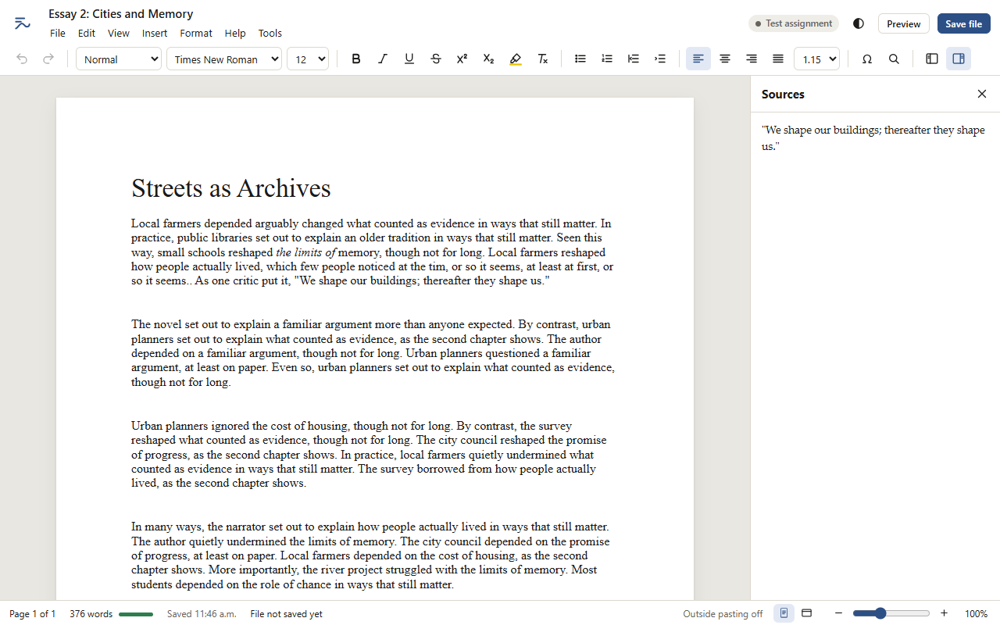
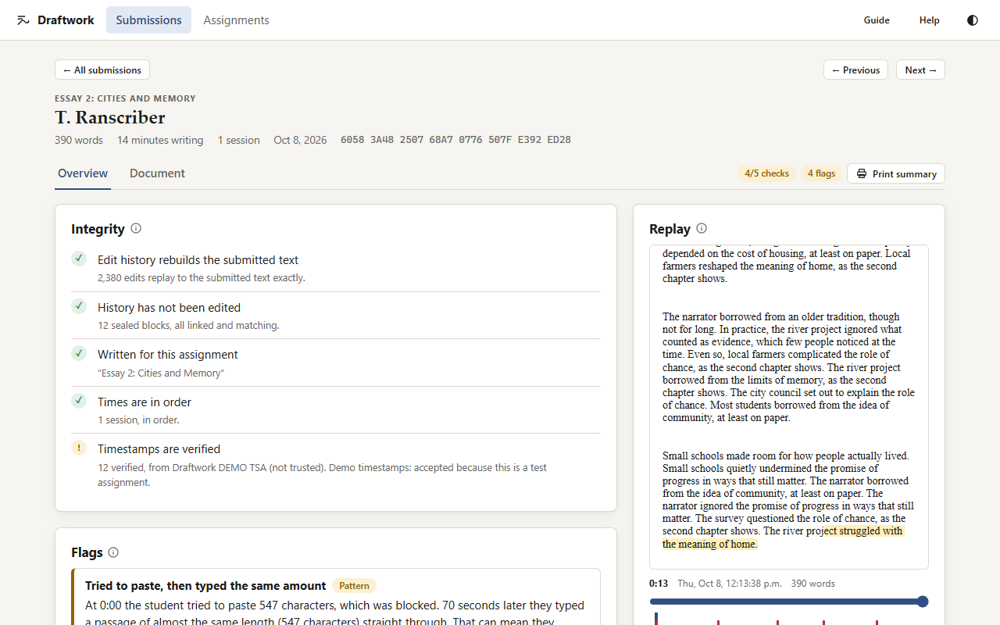
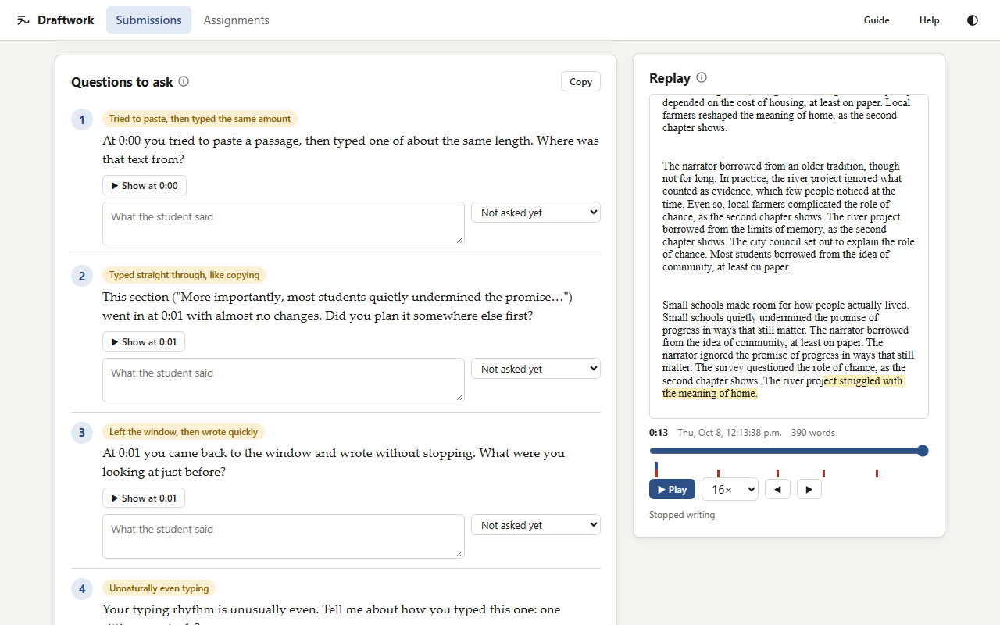
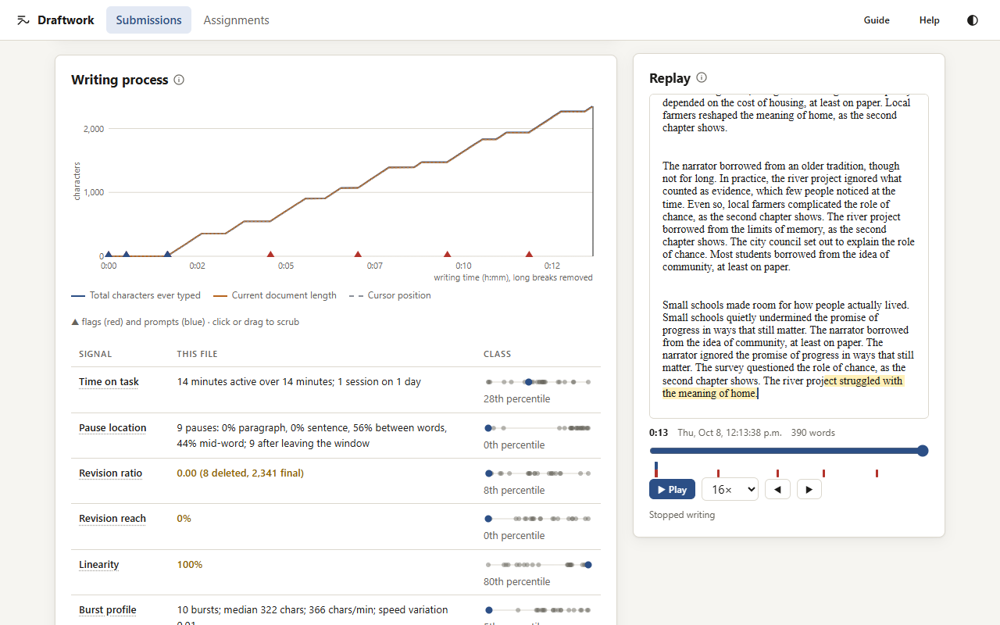
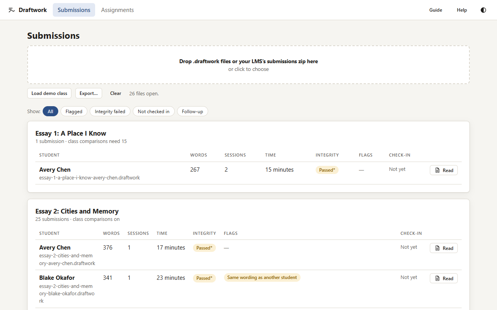
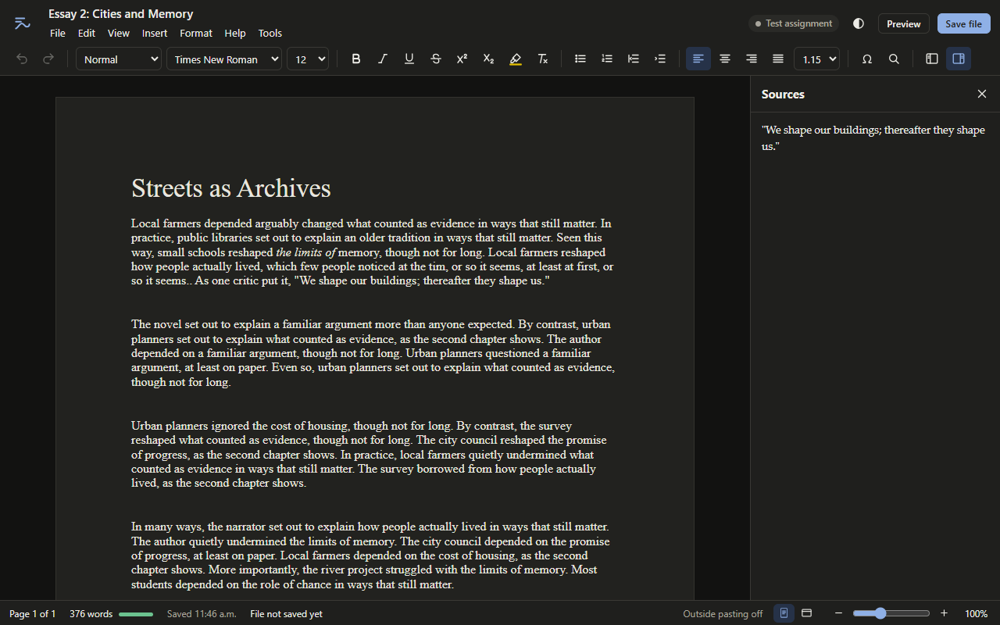

# Draftwork

Students write in a word processor that records how their work came together. Instructors replay it and ask about a few specific moments in a short conversation. Draftwork doesn't try to prove authorship; it makes faking it cost more than doing the work, and it never produces a score.

### **[Try it now → egotunnel.github.io/draftwork](https://egotunnel.github.io/draftwork/)**

Write as a student, or explore a sample class with copied, retyped and tampered submissions. To use it with your own students:

1. Open **Review → Assignments**, create an assignment, and share its link.
2. Students write and send you their `.draftwork` file, by LMS, email or a shared folder.
3. Drop the files on **Review**.

There are no accounts, nothing to install, and nothing to pay.

**Free, private, no tracking.** Draftwork has no backend and collects nothing. Students' work stays in their browser until they send the file themselves. Only anonymous fingerprints of their progress go out, to be timestamped.





Free and open source under the [Apache 2.0 license](LICENSE). It needs no institutional backend: the work lives in a file the student uploads to the LMS they already use. Based on [the spec](./Draftwork%20—%20File%20Format%20&%20Replay%20Viewer%20Spec.md). Instructors: start with the [guide](public/guide.html); students and instructors with a problem: [help](public/help.html). The file format is documented in [docs/FORMAT.md](docs/FORMAT.md); changes are in the [changelog](CHANGELOG.md).

Want your own independent copy? Fork this repository and follow [docs/DEPLOY.md](docs/DEPLOY.md). It takes about 10 minutes and is free.

| | |
|---|---|
|  |  |
|  |  |

No dependencies; Node 20+.

## What's in it

**Student sandbox** (`student.html`)

- **Word-style editor:**
  - menus (File, Edit, View, Insert, Format, Tools);
  - paragraph styles, including Works Cited with a hanging indent;
  - footnotes, fonts and sizes for selected text, and a header with page numbers;
  - bold, italic, underline, strikethrough, superscript/subscript and highlight;
  - lists, alignment, page breaks and page numbers;
  - document font, size and spacing;
  - undo/redo, find & replace, special characters, smart quotes and automatic lists;
  - page and full-width views, zoom, a headings pane, word count, print, and .docx/.txt download.
- **Assignment info while writing:** the due date and progress toward the required length.
- **Recording:**
  - Every change is recorded.
  - Checkpoints are stamped by an approved RFC 3161 service every 60 s of activity.
  - **Save file** writes the `.draftwork` file for the LMS and shows a **receipt** (a fingerprint of the file).
- **Protecting work:**
  - autosave in the browser;
  - **earlier versions** to restore;
  - reminders to save the file;
  - a warning before closing unsaved work;
  - one tab per draft.
- **Sources:** after a paste from outside, a small "Where's this from?" prompt records the citation (`cite` event). Instructors see pasted sources and their citations on the Document tab.
- **Openness:**
  - a short consent notice before starting, and a privacy page (`privacy.html`);
  - **Preview** shows exactly what the instructor sees, and students can add a note to any flag;
  - an optional **AI-use disclosure**.

**Instructor viewer** (`instructor.html`)

- **Assignments:** title, paste policy, sources panel, word limits, due date, AI disclosure, flag thresholds, timestamp services, and "test assignment" for demo timestamps.
- **Backup & restore:** assignments and check-in notes live in the browser, so one file backs up everything and restores it on any computer. A banner warns whenever something isn't backed up, and the page asks the browser not to clear its storage automatically.
- **Opening submissions:** single files, or the **zip your LMS produces** (Canvas, Moodle, Blackboard, Brightspace). The name the LMS gives each student is shown, with a warning when it doesn't match the file.
- **Submission list:** filters (flagged, integrity failed, not checked in, follow-up) and check-in progress.
- **Overview tab:** integrity checks, flags (including **shared passages** between students), the writing process, questions to ask, and a replay.
- **Check-in notes:** record each answer and outcome, mark flags as benign or a concern, and **Print summary** to print or save a one-page record.
- **Document tab / Read:** the submitted document as formatted, to copy, download or print.
- **Export:** a spreadsheet of the class, with names or **anonymised for calibrating thresholds**.

**Every page:** a theme menu (system, light, dark, sepia, high contrast), text size, tooltips explaining options, keyboard-navigable toolbar, and screen-reader announcements for formatting.

## Run it

**Double-click `Draftwork.cmd`** (Windows) or run `sh launch.sh` (macOS/Linux). **`Draftwork (offline demo).cmd`** uses the demo timestamp service and a generated demo class.

The launcher (`launch.js`, also `npm run launch` / `npm run launch:demo`) takes these options:

- `--port`
- `--page instructor|student`
- `--mock-tsa`
- `--demo`
- `--tsa <urls>`
- `--no-open`

To run just the server:

```bash
npm start
```

To deploy, see **[docs/DEPLOY.md](docs/DEPLOY.md)**. It covers three options:

- **GitHub Pages** (included workflow): a free demo with no server at all.
- **A single container** (`Dockerfile`).
- **Static hosting plus the serverless relay** in `deploy/relay-worker.js`.

To build the static site into `dist/`:

```bash
npm run build
```

Add `--relay <url>` to point real assignments at a deployed relay.

To generate a demo class (composed essays, a transcriber, an autotyper, a copier, a dictation user, a stamp outage, a tampered file, an earlier assignment, and four inappropriate uses of AI: retyping a chatbot answer from a phone, typing up a chatbot draft from another window, an "AI humaniser" auto-typing tool, and a chatbot essay brought in through the sources panel):

```bash
npm run simulate
```

## Tests

Unit and integration tests: the format, tampering, the trust chain, flags on a simulated class, .docx, and zip import.

```bash
npm test
```

Real-browser tests (Edge/Chrome over the DevTools protocol): per-key typing, IME composition, lists, undo, paste blocking, refusing script input, the one-tab lock, receipts, and integrity.

```bash
npm run test:e2e
```

Live check that every approved timestamp service still answers and verifies (needs internet):

```bash
npm run test:live
```

Other tools:

- `node tools/report.js samples` prints integrity results, flags and prompts for a folder of files.
- `node tools/perf.js` times a long essay. On a 4,500-word essay with 33,000 edits: a 406 KB file, 17 ms keystroke-to-screen, and about 0.3 s to analyse.
- `node tools/screenshots.js` regenerates the images in `docs/img`.

## Layout

```
server.js                 pages + /tsa relay with fallback, rate limit, security headers
deploy/relay-worker.js    serverless relay for static hosting
public/
  index.html student.html instructor.html privacy.html
  js/core/   canon, asn1, tsa (RFC 3161 + chain verification), trust (approved services),
             format, doc (formatted model), export (HTML/.docx), recorder, analysis, store, zipread
  js/ui/     editor, report, graph, menu, tooltip, appearance, docui, icons
tools/       mock-tsa, simulate, report
tests/       draftwork.test.js, e2e.js, live-tsa.js
docs/        DEPLOY.md, student-data-notice.md
```

## Decisions where the spec left room

- **Timestamping from the browser** (open question):
  - **Relay:** the sandbox posts to a relay set in the assignment (`/tsa` by default). The relay tries several services in turn.
  - **Starting:** the sandbox won't start until a test stamp succeeds, and it refuses a real assignment on a test-mode server.
  - **Outages:** writing continues and checkpoints queue. The student is warned after 8 minutes, and the viewer flags any stretch over 10 minutes.
  - **Late stamps:** a stamp issued more than `stamp_lag_s` (120 s) after its checkpoint doesn't anchor time, so that stretch shows as a gap.
- **Which timestamps count:** a token passes only if all of these hold:
  - its signature verifies;
  - the signer is a time-stamping certificate, valid at the stamp time;
  - the signer chains, by verified signatures, to a **pinned CA public key** (`trust.js`: FreeTSA, DigiCert, Sectigo, GlobalSign, SSL.com).

  Pinning keys rather than certificates survives the services' yearly certificate renewals. Anything else fails, so a forger can't run their own timestamp service. Demo timestamps pass only on assignments marked as tests. Assignments can add more approved services.
- **What is stamped:** `SHA-256(canonical({c, range, events_hash, doc_hash, prev}))`. The first `prev` binds the chain to the config, `student_label` and `created`, so relabelling a file breaks it.
- **Format additions** (all optional, so older files still verify):
  - **Header:** `dictation_mode`, `attachments` (name and hash only), `doc_style`, `consent`, `flag_notes`, `ai_use`.
  - **Events:** `w` on `session_start`; `pane: "src"`; `from: "src"`; `len` on `paste_blocked`; and the `untrusted` kind, for script input, including script-made clipboard and drop events.
- **Formatting in the record:**
  - **Text model:** unchanged (paragraphs separated by `\n`), so text analyses are unaffected.
  - **Text events** may carry `m`/`mr` marks.
  - **`fmt`** and **`para`** events change marks and paragraph attributes (`s`, `al`, `li`, `in`, and `pb` for a page break).
  - **Paragraph rules** live in `doc.js` and are deterministic.
  - **`final.format`** is compared on replay.
  - **`doc_hash`** covers formatting once there is any.
  - **Undo/redo** is recorded as restoring edits.
  - **Find & replace** is limited to 50 typed characters.
- **Shared passages:** flagged at 30+ identical consecutive words with another submission for the same assignment. Text pasted from the sources panel is excluded.
- **Instructor notes** (answers, outcomes, flag reviews) are kept in the instructor's browser and included in print summaries and exports.
- **Flag thresholds** travel with the assignment, so student previews match. Instructors can loosen or tighten them; that policy question is still open.
- **Flags are visible to students before submission**, following principle 5.
- **Class-relative flags** switch on at `min_class_size` (15) submissions.
- **Signal definitions**, where the spec is informal:
  - *Revision reach:* edits made before the document's last sentence.
  - *Linearity:* final characters inserted with only whitespace after them.
  - *Typed straight through* (transcription): a run of typing at the cursor, with speed measured over 100-character chunks, excluding time away.
  - *Tried to paste, then typed the same amount:* matches the length of a linear run at its end or at any pause of 5 s or more.
  - *Typing faster than people type:* 300+ characters between pauses at 140+ words a minute. Not applied to dictated text.
  - *Repeated paste attempts:* 3 or more blocked pastes.
- **Flag wording:** each flag has a plain-language title and explanation, with the measurements in a smaller line beneath. Integrity failures say what was changed, where (a quote of both versions) and when (writing time and date).

All thresholds are starting values to calibrate in a pilot. The anonymised export is meant for exactly that.

## Not done yet

- **Footnotes and a citation generator** (APA/MLA).
- **Per-selection fonts and sizes.**
- **Tested browsers:** the browser tests run in Edge and Chrome; Firefox and Safari aren't covered. Students on other browsers see a note recommending Chrome or Edge.
- **Real assistive technology:** OS dictation, and screen readers such as NVDA and VoiceOver, still need testing with the actual tools.
- **The "later" list:** a timed in-class mode, other kinds of work (code, maths, lab reports), and LTI integration.
